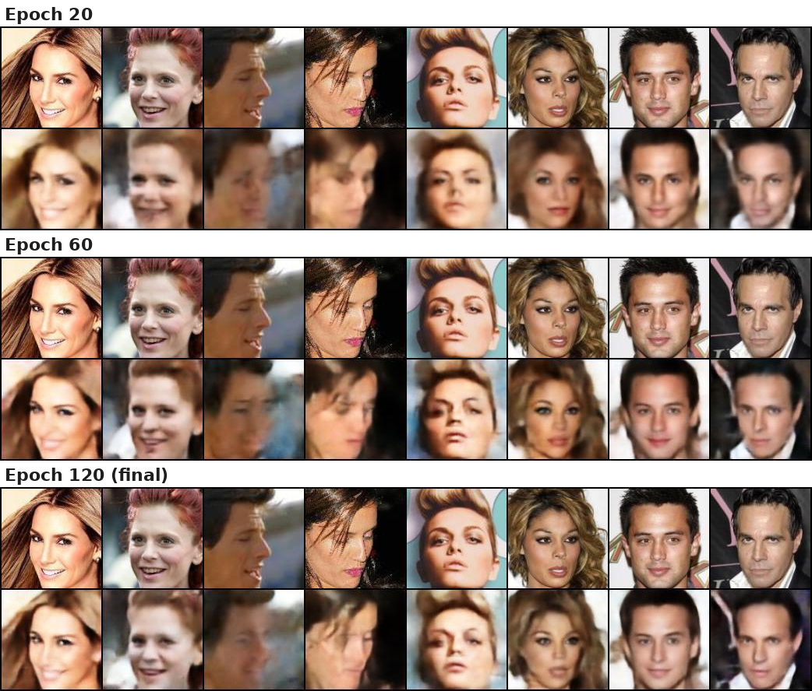
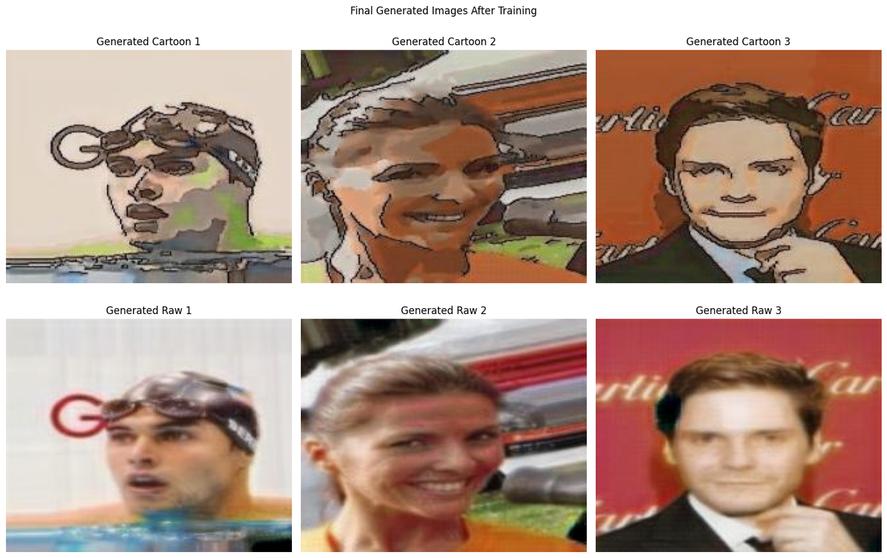

# Generative Vision Projects

Deep generative models for images, built in PyTorch: a **variational autoencoder** that learns to reconstruct and generate faces, and a **CycleGAN** that translates images between domains without paired training data. I did both as part of university coursework in deep learning for computer vision.

> **About the code:** this repo is a showcase of the design, results and lessons learnt. The source code is kept private because these were graded coursework. **Code is available on request.** Reach me via [LinkedIn](https://www.linkedin.com/in/tan-song-jun).

---

## Projects

### [1. Variational Autoencoder for face generation →](vae/)

A ResNet-style VAE that compresses 128×128 face images into a 128-dimensional latent space and reconstructs them. It had to fit within a **26 MB model size limit**.

**Result:** GMS 7.71 · 5.5M parameters (21 MB) · Solo project

---

### [2. CycleGAN for unpaired image translation →](cyclegan/)

Two generators and two PatchGAN discriminators learn to translate **photos ↔ cartoons** and **horses ↔ zebras** without paired examples, using adversarial, cycle-consistency and identity losses. We also experimented with custom domain pairs.

**Result:** Horse→zebra GMS 7.68 · Zebra→horse GMS 8.17 · Team of 4

---

## Skills demonstrated

- Designing encoder–decoder networks with **residual blocks**, **skip connections** and **PatchGAN** discriminators
- Probabilistic generative modelling: the **reparameterisation trick**, **KL regularisation** and **β-VAE** experiments
- Stabilising GAN training with **mixed precision**, **gradient clipping**, **replay buffers** and **learning-rate decay**
- Working within a hard **model size budget**
- **Systematic experimentation**: a fixed baseline, one change at a time, with every run logged
