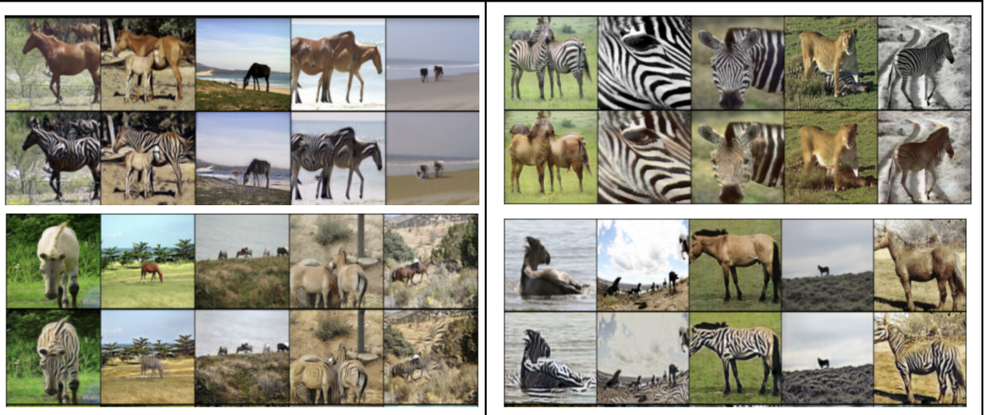
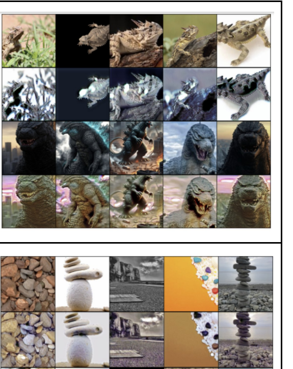
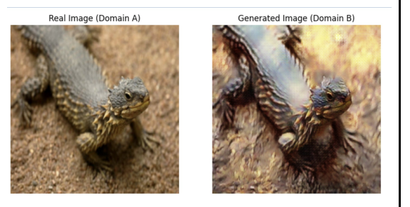
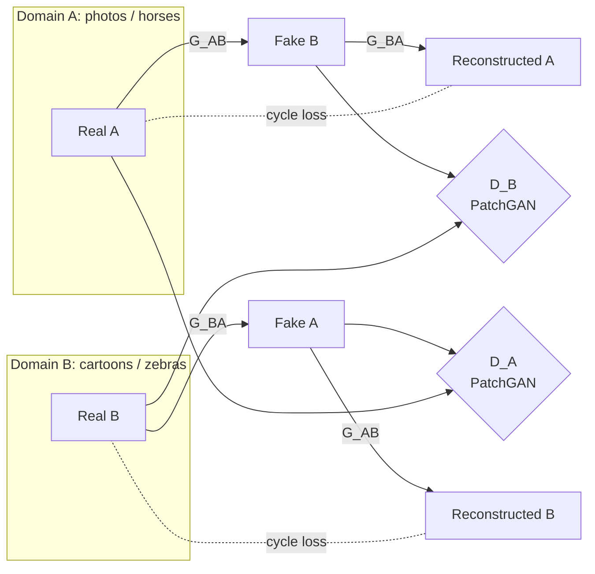
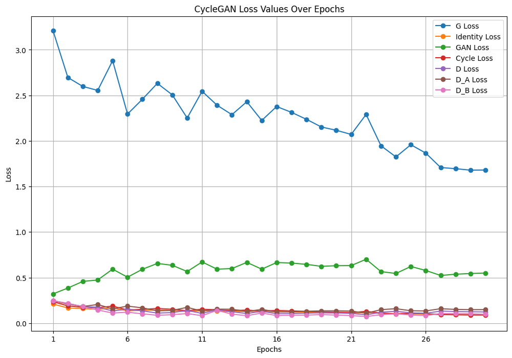

# CycleGAN for Unpaired Image Translation

Translating images between two visual domains, such as **photo ↔ cartoon** and **horse ↔ zebra**, without any paired examples. The model learns from two separate image collections and uses *cycle consistency* to keep the content intact.

**Team project** with Garion, Zhi Wei and Jonathan.

> Code kept private (graded coursework). Available on request. [← Back to all projects](../)

---

## Results

### Task 1 — Photos ↔ cartoons

| Direction | GMS |
|---|---|
| Photo → cartoon | 4.01 |
| Cartoon → photo | 2.96 |

### Task 2 — Horses ↔ zebras

In each pair of rows, the top row is the original and the bottom row is the translation.

| Direction | GMS |
|---|---|
| Horse → zebra | 7.68 |
| Zebra → horse | 8.17 |

### Custom domain experiments

For Task 2 we were free to pick our own domains, so we tried several pairings before settling on one:

| Lizards → Godzilla, pebbles → shells | Lizards → dragons |
|---|---|
|  |  |

Colour and texture transferred well, but **shape** mostly did not. A lizard picks up dragon-like scales but keeps its lizard body. That's a known limitation of CycleGAN, which is good at style and texture changes but not at changes in geometry. Horse ↔ zebra gave the clearest results, so that's what we submitted.

## Architecture

**Generators.** ResNet-style encoder–decoders, one for each direction:

- Task 1: a 7×7 reflection-padded input convolution, two strided downsampling convolutions, and residual blocks with dropout. The decoder has U-Net-style **skip connections** that concatenate encoder features, which helps keep facial structure through the translation.
- Task 2: the classic CycleGAN generator, with **9 residual blocks** and nearest-neighbour upsampling plus convolution instead of transposed convolutions, to avoid checkerboard artefacts.

**Discriminators.** **PatchGAN** CNNs that classify overlapping image patches as real or fake instead of the whole image. This pushes the generator towards sharp local texture.

**Losses.** Adversarial loss (least-squares GAN, using MSE), **cycle-consistency** loss (A → B → A should return the original), and **identity** loss (an image already in the target domain should pass through unchanged, which preserves colour).

## Training

| Setting | Value |
|---|---|
| Optimiser | Adam, lr 2e-4, betas (0.5, 0.999) |
| Learning-rate schedule | Constant, then linear decay to 0 over the second half |
| Batch size | 4 |
| Stability | Mixed-precision training (`torch.amp`), gradient clipping at 1.0, a replay buffer of 50 past fakes for the discriminators |

## What we learnt

- **Less is more.** Minimal augmentation worked best for photo ↔ cartoon, and training beyond about 50 epochs made results *worse*. That's typical of GANs, where generator and discriminator can drift out of balance.
- **Stabilisation tricks matter for GANs.** Mixed precision cut memory use and training time. Gradient clipping and the replay buffer stopped the discriminator from overpowering the generator.
- **Data is the hardest part.** With free choice of domains, finding, scraping and cleaning matching image sets took more effort than the modelling did.
- **Know the model's limits.** CycleGAN changes appearance, not structure. Choosing domains that differ mainly in texture is the key to good results.
