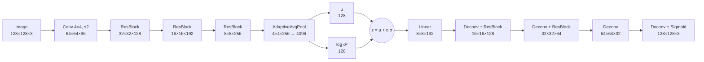

# Variational Autoencoder for Face Generation

A convolutional VAE with residual blocks, trained on 5,000 celebrity face images to reconstruct and generate 128×128 faces under a strict **26 MB model size limit**.

**Final result:** GMS **7.71** · **5.5M** parameters (**21 MB**) · trained for 120 epochs

> Code kept private (graded coursework). Available on request. [← Back to all projects](../)

---

## Results

Top row of each pair: original image. Bottom row: VAE reconstruction.

The early epochs only capture overall colour and pose. By the final epoch the model reproduces hair shape, facial structure and expression. As you'd expect from an MSE-trained VAE, fine detail stays soft.

## Architecture

- **Encoder:** an initial strided convolution, then three downsampling residual blocks (96 → 128 → 192 → 256 channels), adaptive average pooling, and two linear heads for μ and log σ².
- **Latent space:** 128 dimensions, sampled with the reparameterisation trick so the model stays differentiable. A 256-dimensional latent exceeded the 26 MB budget, so 128 was the best trade-off.
- **Decoder:** a linear projection to 8×8×192, then four transposed convolutions back up to 128×128, with refinement residual blocks in between and a sigmoid output.
- **Residual blocks:** two 3×3 convolutions with batch norm and LeakyReLU (0.2), plus a 1×1 projection on the skip path when the shape changes. LeakyReLU avoids dead neurons, and the skip connections keep gradients healthy through the deeper network.

## Training

| Setting | Value |
|---|---|
| Loss | MSE reconstruction + KL divergence (β = 1) |
| Epochs | 120 |
| Training data | 5,000 face images (178×218) |
| Preprocessing | Resize shortest side to 160, then centre-crop to 128×128 |

**What I tried:**

- **β-VAE weighting.** I tested several reconstruction-to-KL ratios. The standard β = 1 gave the best score for this model.
- **Augmentation.** Random flips, rotations and colour jitter all made results *worse*. For a reconstruction task, they add variation the model then has to spend capacity on.
- **Aspect-ratio handling.** I compared padding to the target aspect ratio against resize-and-centre-crop. Cropping kept the face, which is the most important region, and scored better.

## What I learnt

- **Build in order, and don't tune early.** I settled the architecture before touching augmentation. In an earlier assignment I'd tweaked everything at once and couldn't tell what helped.
- **Change one thing at a time against a fixed baseline.** I organised runs into iterations: one baseline plus 5–10 single-change experiments. At the end of each iteration, I merged the winning changes into a new baseline.
- **Log everything.** Each Kaggle run took 30+ minutes, so a structured experiment log (in OneNote) was what made the process efficient rather than guesswork.
